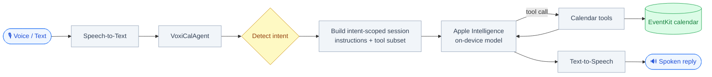
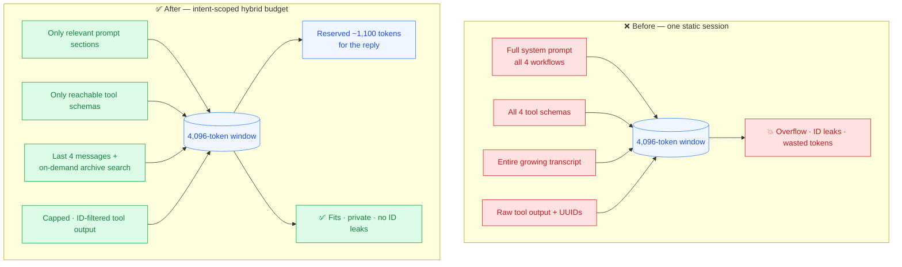
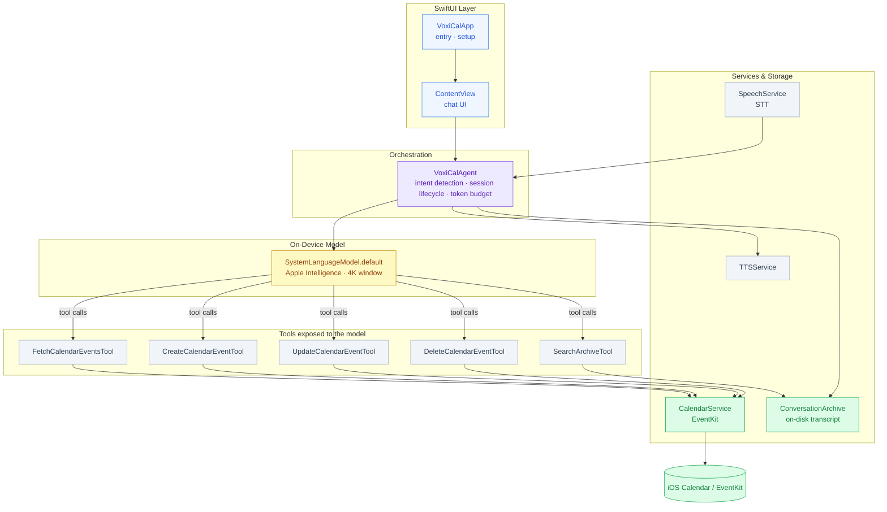

<table>
  <tr>
    <td width="180" valign="middle">
      
    </td>
    <td valign="middle">
      <h1>VoxiCal</h1>
      <strong>A fully on-device, voice-first calendar assistant. Speak to check your schedule, create meetings, and reschedule events — no cloud, no API keys, no data leaving your phone.</strong>
      <br /><br />
      <p>VoxiCal runs entirely on Apple Intelligence's on-device foundation model. It turns natural speech like <em>"schedule a 1:1 with Priya next Friday at 2pm for 45 minutes on Zoom"</em> into real calendar actions, while keeping every token of your schedule private to the device.</p>
    </td>
  </tr>
</table>

---

## Demo Video: [Link](https://youtube.com/shorts/GKEMYobACSU?si=kDWO2EsG4f-IyYIi)

https://github.com/user-attachments/assets/c97447b8-e3df-453a-89ca-5a6496da58a0

## Technical Blog

- [Siri Has Already Forgotten This Conversation](https://ramyalakshmiiks.substack.com/p/siri-has-already-forgotten-this-conversation)
- [Building the Thing I Wished Existed](https://ramyalakshmiiks.substack.com/p/building-the-thing-i-wished-existed)

The blog posts go deeper on the engineering story and the motivation; this README stays fully self-contained without them.

---

## Table of Contents

- [The Problem](#the-problem)
- [What VoxiCal Does](#what-voxical-does)
- [Key Engineering Highlights](#key-engineering-highlights)
- [The Biggest Engineering Challenge: Managing the LLM Context Window](#the-biggest-engineering-challenge-managing-the-llm-context-window)
- [System Architecture](#system-architecture)
- [Technology Stack](#technology-stack)
- [Installation and Reproducibility](#installation-and-reproducibility)
- [Testing and Evaluation](#testing-and-evaluation)
- [Project Structure](#project-structure)
- [Engineering Decisions and Trade-offs](#engineering-decisions-and-trade-offs)
- [Limitations and Future Improvements](#limitations-and-future-improvements)
- [License](#license)

---

## The Problem

Calendar apps are fast to *read* but slow to *act on*. Creating or moving an event means tapping through forms — a date picker, a time picker, a duration field, a location field — which is exactly the kind of task you want to do hands-free while walking, driving, or cooking.

Voice assistants promise this but historically came with a cost: your schedule — who you meet, when, and where — is sent to a cloud service. For something as sensitive as a calendar, that trade-off is hard to accept.

Apple's on-device foundation model removes the privacy cost, but introduces a hard engineering constraint in its place: a **4,096-token context window**. A calendar assistant is unavoidably tool-heavy (fetch, create, update, delete) and multi-turn (clarifying times, durations, locations). Naively assembling the system prompt, all tool schemas, the full conversation, and raw tool output overflows that window fast — and when it does, the assistant either errors out or silently forgets what you told it. Making a genuinely useful assistant fit inside 4K tokens is the core challenge this project solves.

## What VoxiCal Does

You talk; VoxiCal acts on your real calendar.

- **Read** — *"What's on my schedule today?"*, *"Do I have a meeting with Sarah?"* VoxiCal fetches from your calendar and answers in one spoken sentence.
- **Create** — *"Add a gym session tomorrow at 7am for 45 minutes."* It collects any missing details, checks for conflicts, and creates the event.
- **Update / reschedule** — *"Move my team standup to 10am."* It finds the event and changes only what you asked.
- **Delete** — *"Cancel my dentist appointment."* It names the event for confirmation before removing it.

Everything is spoken-first: speech is transcribed on device, the agent reasons locally, and replies are read back through text-to-speech in plain prose (no markdown, since markdown sounds broken when spoken aloud).

The core turn flow:



## Key Engineering Highlights

- **100% on-device inference** — built on `SystemLanguageModel.default` (Apple Intelligence). No network calls, no API keys, no calendar data leaving the phone. See [`VoxiCalAgent.checkModelAvailability`](ios/VoxiCal/VoxiCal/VoxiCalAgent.swift).
- **Intent-scoped context budgeting** — the system prompt and the tool set are both assembled *per intent*, so a read query doesn't pay the token cost of create/update/delete rules and schemas. ([details below](#the-biggest-engineering-challenge-managing-the-llm-context-window))
- **Tool-output filtering that prevents ID leaks** — the fetch tool splits human-readable text from an `[INTERNAL]` event-ID block, so raw UUIDs can never end up in a spoken reply. Enforced and tested by `noUUIDInResponseGrader`.
- **Deterministic client-side fast-path** — regex extractors gather event fields on-device and only invoke the model once all required fields are present, eliminating multi-turn clarification round-trips. See [`clarificationForAmbiguousCreateRequest`](ios/VoxiCal/VoxiCal/VoxiCalAgent.swift).
- **A real, runnable eval suite** — nine golden scenarios driven through the actual on-device model with a mock calendar, graded by code. Run with one `xcodebuild test` command.
- **Voice-safe output discipline** — the agent is constrained to plain conversational prose and must never claim a calendar change it didn't make (`noFalseSuccessClaimGrader`).

## The Biggest Engineering Challenge: Managing the LLM Context Window

This is the technical heart of the project. The full write-up — with per-technique hypotheses, trade-offs, and code links — lives in **[docs/context-window-experiments.md](docs/context-window-experiments.md)**. This is the engineering story in brief.

### The Problem → Initial Approach → Limitations

VoxiCal's model has a **4,096-token window** that must hold *everything at once*: system instructions, all tool schemas, the conversation so far, every tool result, and the room needed to generate a reply.

The initial approach was the obvious one: build a single session with the complete system prompt, register all four calendar tools, and let the conversation transcript grow turn after turn, feeding raw tool output straight back to the model. On a 128K-token cloud model this is fine. On a 4K on-device model it broke in four concrete ways:

| Symptom | Root cause |
|---|---|
| Context overflow on longer chats | Full transcript + all four tool schemas never shrank |
| Event IDs spoken aloud to the user | Raw tool output (with UUIDs) fed back verbatim |
| Tokens wasted on unreachable tools | A read query still paid for create/update/delete schemas |
| Retry loops and date-math errors | Empty results weren't terminal; the model did its own date arithmetic |

This wasn't a one-line fix. The Git history carries dedicated `context-management` and `context-engineering` branches and commits like *"Archive context to handle memory window limit"*, *"system prompt length, prompt-code alignment & per-intent tool restriction"*, and *"add cache to optimize context window."*

### Alternatives Explored

| Technique | Decision | Reasoning |
|---|---|---|
| Keep full conversation history | ❌ Rejected | Unsustainable in 4K tokens; overflows within a few multi-turn exchanges. |
| Sliding window only | ⚠️ Partial | Used for *recent* continuity (last 4 messages), but discarding older facts outright loses information. |
| Conversation summarization | 🔭 Proposed | A summarizer costs an extra model call on an already-tight budget; archival + retrieval achieves the goal more cheaply. |
| Retrieval-based memory | ✅ Adopted | History is written to disk and fetched on demand via a search tool — only relevant slices re-enter the window. |
| Tool-output filtering | ✅ Adopted | The least predictable context source; capped and ID-filtered. |
| Dynamic token budgeting | ✅ Adopted | Separate, protected headroom for the response; proactive archival before overflow. |
| Intent-scoped instructions + tools | ✅ Adopted | The biggest structural win — most of the prompt and most tool schemas are irrelevant to any one turn. |

### Final Solution: a hybrid, intent-scoped context budget

Instead of one trick, VoxiCal budgets each category of context independently:

1. **Instructions scale with intent** — [`buildInstructions(for:)`](ios/VoxiCal/VoxiCal/VoxiCalAgent.swift) concatenates only the prompt sections a given intent needs.
2. **Tool schemas scale with intent** — [`buildSession(for:)`](ios/VoxiCal/VoxiCal/VoxiCalAgent.swift) loads only the reachable tools (e.g. a read turn loads just `fetch` + `search`).
3. **Dates are pre-computed** — a compact date prefix gives the model literal ISO dates so it never spends tokens on date math.
4. **Tool output is bounded** — [`FetchCalendarEventsTool`](ios/VoxiCal/VoxiCal/CalendarTool.swift) caps results at 25 events and separates user-facing text from an `[INTERNAL]` ID block.
5. **Output headroom is protected** — [`estimatedSessionTokens()`](ios/VoxiCal/VoxiCal/VoxiCalAgent.swift) archives and resets the session when usage approaches ~3,000 of 4,096 tokens, reserving ~1,100 for the reply + tool calls; a reactive handler recovers if an overflow still slips through.
6. **Memory is retrieved, not retained** — [`ConversationArchive`](ios/VoxiCal/VoxiCal/ConversationArchive.swift) persists the transcript to disk and [`SearchArchiveTool`](ios/VoxiCal/VoxiCal/SearchArchiveTool.swift) lets the model pull back only the relevant snippet, with the last four messages kept hot for continuity.

### Before and After



### Why it worked, and the trade-offs that remain

The intent-scoping is the structural win: by refusing to load context a turn can't use, the window has room for the parts that matter. Retrieval-based memory means a budget-triggered reset never *loses* the user's facts — they're on disk and searchable. Protecting output headroom turns a hard failure mode into a silent recovery.

Honest trade-offs: the `.unknown` intent still loads everything (ambiguous phrasing forfeits the savings); archive search is keyword-based, not semantic, so a paraphrased recall can miss; the token estimate is a ~4-chars/token heuristic, not a true tokenizer; and the 25-event cap truncates very broad queries rather than paginating. These are documented, intentional boundaries — see [docs/context-window-experiments.md](docs/context-window-experiments.md).

> **A note on measurement.** The on-device model has no token-billing API, and this repo does not log per-request token counts, so the token figures above are the design estimates encoded in the code's own comments — not benchmark output. What *is* verifiable by running the suite is the resulting **behavior**: no ID leaks, correct tool selection, graceful empty results, and no false success claims.

## System Architecture

VoxiCal is a single SwiftUI app with one orchestrator (`VoxiCalAgent`) that owns the model session, the tools, and all UI state.



**Request flow.** Voice or text enters `VoxiCalAgent.sendMessage`. The agent detects intent, checks the token budget (archiving if needed), and builds an intent-scoped session. The model reasons locally and calls calendar tools as needed; tool results are filtered before returning to the model; the final plain-text reply is spoken via `TTSService`.

**Why this architecture.** A single orchestrator that owns the session is what makes per-intent context budgeting possible — the agent can tear down and rebuild the session with a different prompt/tool set the moment the user's goal changes, which is the mechanism behind the context-window strategy. Tools are the only way the model touches the calendar, so every calendar mutation flows through one validated path (`CalendarService` + `CalendarTool`), where conflict detection and field validation live.

## Technology Stack

| Technology | Role | Why it was chosen |
|---|---|---|
| **Swift + SwiftUI** | App, UI, orchestration | Native iOS; `@Observable` makes the agent a single source of truth for UI state. |
| **FoundationModels (`SystemLanguageModel.default`)** | On-device LLM | Private, offline, free inference — the entire reason the app can be voice-first without shipping calendar data to a server. |
| **FoundationModels tool calling (`Tool` + `@Generable`)** | Agent ↔ calendar actions | Structured, schema-guided tool arguments; the model calls tools instead of emitting free text to mutate state. |
| **EventKit** | Real calendar read/write | The system calendar store, so events created by VoxiCal appear everywhere the user's calendar does. |
| **Speech + AVFoundation (TTS)** | Voice in / voice out | On-device speech recognition and synthesis keep the voice loop local. |
| **XCTest + custom eval harness** | Agent-behavior evaluation | Drives the real model against a mock calendar and grades tool use and output discipline. |

## Installation and Reproducibility

VoxiCal is an iOS app that depends on **Apple Intelligence**, which runs on the Mac's/host device's Apple Silicon. There are **no package dependencies to install and no API keys** — all inference is on-device.

### Prerequisites

- **macOS** with **Xcode 16+** (tested against the iOS 26 SDK / iPhone 17 Pro simulator).
- An **Apple Silicon Mac** (A17 Pro / M-series) with **Apple Intelligence enabled**. The on-device model is required; the app shows a banner and disables itself if the model is unavailable.
- A real device or simulator running **iOS 26.4+**.

> There is **no `.env` file and no `.env.example`** in this project. VoxiCal has no secrets, keys, or external services to configure — this is intentional, and a direct consequence of the on-device-only design.

### 1. Clone

```bash
git clone https://github.com/RamyaLakshmiKS/VoxiCal.git
cd VoxiCal
```

### 2. Open in Xcode

```bash
open ios/VoxiCal/VoxiCal.xcodeproj
```

### 3. Run the app

Select the **VoxiCal** scheme and an iPhone 17 Pro (or newer) simulator / device, then press **Run** (⌘R). On first launch the app:

1. Checks Apple Intelligence availability.
2. Requests calendar access (needed to read and write events).
3. Builds the model session and greets you.

Then speak or type: *"What's on my schedule today?"* or *"Schedule a team sync tomorrow at 3pm for 30 minutes on Zoom."*

### Common setup problems

- **Orange "Apple Intelligence is not available" banner** — the host lacks a supported chip or Apple Intelligence is turned off. Enable it in Settings, or run on an Apple Silicon Mac's simulator.
- **No events found / can't create** — grant calendar access when prompted (or in Settings → Privacy → Calendars).

## Testing and Evaluation

VoxiCal ships a code-driven **eval suite** that runs nine golden scenarios through the *real* on-device model against a mock calendar ([`MockCalendarService`](ios/VoxiCal/tests/EvalCore.swift)), then grades each one with code-based graders. This validates agent *behavior* (tool selection, output discipline, hallucination guards), not just compilation.

```bash
xcodebuild test \
  -project ios/VoxiCal/VoxiCal.xcodeproj \
  -scheme VoxiCal \
  -destination "platform=iOS Simulator,name=iPhone 17 Pro" \
  -only-testing:VoxiCalTests
```

Expected console output (abbreviated):

```
EVALUATION RESULTS
[✓ PASS] Hi, how are you?                         (Greeting — no tool call)
[✓ PASS] Do I have a meeting with Sarah today?    (Meeting lookup)
[✓ PASS] Do I have a meeting with Sarah today?    (Hallucination guard)
[✓ PASS] Schedule a team sync tomorrow at 3pm...  (Create)
[✓ PASS] Schedule a sync tomorrow at 9am...       (Conflict detected)
[✓ PASS] Move my team standup to 10am             (Update)
[✓ PASS] Reschedule my 1:1 with Sarah to 2pm      (Update, not create)
[✓ PASS] I want to schedule a meeting with Karthik (Asks for missing details)
[✓ PASS] What's on my schedule today?             (No eventID leak)
SUMMARY: 9/9 passed
** TEST SUCCEEDED **
```

What the suite validates:

- **Tool selection** — read vs. create vs. update intents reach the right tool.
- **Hallucination guard** — the agent only reports events the tool actually returned.
- **Conflict detection** — overlapping create requests are surfaced, not silently created.
- **Output discipline** — no event IDs, no false "successfully created" claims, plain-text replies.

The golden suites are documented in [ios/VoxiCal/evals/golden/README.md](ios/VoxiCal/evals/golden/README.md), and map to the nine `goldenTestCases` in [`tests/EvalCore.swift`](ios/VoxiCal/tests/EvalCore.swift). A `#if DEBUG` **Run Evals** button is also wired into the app toolbar ([`ContentView`](ios/VoxiCal/VoxiCal/ContentView.swift)).

> **Known limitation — non-determinism.** The evals call the real on-device model, whose default decoding is random sampling, so individual runs vary. The runner re-attempts each scenario up to three times (`maxAttemptsPerScenario`) to absorb this. Deterministic runs are possible via Apple's `GenerationOptions` greedy sampling, which is not currently wired in.

## Project Structure

```
VoxiCal/
├── README.md                         ← you are here
├── LICENSE                           ← MIT
├── docs/
│   └── context-window-experiments.md ← deep-dive on the context-window strategy
└── ios/VoxiCal/
    ├── VoxiCal.xcodeproj/            ← Xcode project (shared scheme committed)
    ├── VoxiCal/                      ← app sources
    │   ├── VoxiCalApp.swift          ← @main entry; one-time setup()
    │   ├── ContentView.swift         ← SwiftUI chat UI + DEBUG "Run Evals" button
    │   ├── VoxiCalAgent.swift        ← orchestrator: intent detection, session
    │   │                                lifecycle, token budgeting, fast-path
    │   ├── CalendarTool.swift        ← fetch/create/update/delete tools + filtering
    │   ├── CalendarService.swift     ← EventKit read/write
    │   ├── ConversationArchive.swift ← on-disk transcript (retrieval memory)
    │   ├── SearchArchiveTool.swift   ← lets the model search archived history
    │   ├── SpeechService.swift       ← speech-to-text
    │   ├── TTSService.swift          ← text-to-speech
    │   └── ChatMessage.swift         ← chat model
    ├── tests/                        ← eval harness (VoxiCalTests target)
    │   ├── EvalCore.swift            ← mock calendar, graders, runner, 9 golden cases
    │   ├── CreateEventEvals.swift    ← create-path graders
    │   └── EvalSuiteTests.swift      ← XCTest entry point that runs the suite
    └── evals/golden/                 ← YAML golden specs + README mapping to graders
```

Key claims in this README link to their implementation:
[intent-scoped prompt/tools](ios/VoxiCal/VoxiCal/VoxiCalAgent.swift) ·
[tool-output filtering](ios/VoxiCal/VoxiCal/CalendarTool.swift) ·
[retrieval memory](ios/VoxiCal/VoxiCal/ConversationArchive.swift) ·
[eval graders](ios/VoxiCal/tests/EvalCore.swift).

## Engineering Decisions and Trade-offs

- **One orchestrator owns the session.** `VoxiCalAgent` is the single source of truth for UI state *and* the model session. This coupling is deliberate: per-intent context budgeting requires the ability to rebuild the session (new prompt + new tool set) the instant the user's goal changes.
- **Mutations go through tools, never free text.** Every calendar change flows through a `Tool` with schema-validated arguments and server-side guards (conflict detection, required-field checks, generic-title rejection) in [`CalendarTool.swift`](ios/VoxiCal/VoxiCal/CalendarTool.swift). The model proposes; the tool validates.
- **Conflict detection runs before cosmetic checks.** In the create tool, overlap detection is evaluated before the generic-title guard, so a scheduling conflict is always surfaced even for a vaguely-titled request — a correctness decision validated by the conflict eval.
- **Client-side extraction before the model.** Deterministic regex parsing of dates, times, durations, and locations avoids spending scarce tokens on multi-turn clarification when the information is already parseable on-device.
- **Plain-text-only output.** Because replies are spoken, the agent is forbidden from emitting markdown; this is enforced in the prompt and checked by graders.

## Limitations and Future Improvements

**Current limitations**
- **Hardware-gated.** Requires Apple Intelligence on supported Apple Silicon; the app disables itself otherwise.
- **4K-token ceiling.** Very long single sessions still rely on archival + reset; extremely broad queries are capped at 25 events.
- **Keyword archive search.** `SearchArchiveTool` matches substrings, not meaning, so paraphrased recalls can miss.
- **English-centric extraction.** The deterministic fast-path patterns are tuned for English phrasing; other inputs fall back to the full LLM path.
- **Non-deterministic evals.** Grading runs against a sampled model; mitigated with retries rather than greedy decoding.

## License

This project is licensed under the [MIT License](LICENSE) — © 2026 Ramya Lakshmi KS.
